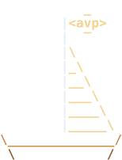

<div align="center">
  
  <h1>Agent Voyager Project (AVP)</h1>
</div>

> **Status:** Draft v0.1

AVP is an open standard for running and observing AI agents. Shared task and
event formats let you run, compare, and inspect agents across different runtimes.

A supervisor sends one JSON **Commission** with the task, model, and resources.
The agent streams a **Trajectory** of model responses, tool calls, usage, cost,
and outcome.

```text
Supervisor ─── Commission ──▶ Agent
Supervisor ◀── Trajectory ─── Agent
```

See the [spec overview](spec/v0.1/README.md) for the three contracts and how
they fit together.

## Run an agent

Install the CLI. Requires
[uv](https://docs.astral.sh/uv/) and a running container engine with a Docker API,
such as Docker or podman:

```sh
uv tool install https://github.com/portofcontext/agent-voyager-project/releases/download/cli-v0.6.0b2/avp_cli-0.6.0b2-py3-none-any.whl
avp agent install pydantic-ai
avp vault set anthropic
```

The vault command prompts for your key. Save this as `task.json`:

```json
{
  "avp_version": "0.1",
  "model": {
    "provider": "anthropic",
    "id": "claude-haiku-4-5",
    "credential": {"proxy": "anthropic"}
  },
  "prompt": "Say hello."
}
```

```sh
avp run --agent pydantic-ai --commission task.json
```

This runs the agent in an OpenSandbox sandbox. The CLI prints the
Trajectory location. See the [command guide](avp-cli/COMMANDS.md) for credentials,
networking and volumes, and the [eval guide](avp-cli/docs/eval.md) for comparisons.

## Agents and SDKs

List the built-in agents and install one by name:

```sh
avp agent list --builtin
avp agent install codex
```

| Runtime | Install name | Adapter |
|---|---|---|
| Claude Agent SDK | `claude-code` | [avp-claude-agent-sdk](agents/avp-claude-agent-sdk/python/) |
| OpenAI Agents SDK | `openai-agents` | [avp-openai-agents](agents/avp-openai-agents/python/) |
| Codex | `codex` | [avp-codex](agents/avp-codex/python/) |
| Pi | `pi` | [avp-pi](agents/avp-pi/typescript/) |
| Gemini CLI | `gemini-cli` | [avp-gemini-cli](agents/avp-gemini-cli/typescript/) |
| LangChain Deep Agents | `deep-agents` | [avp-deep-agents](agents/avp-deep-agents/python/) |
| Pydantic AI | `pydantic-ai` | [avp-pydantic-ai](agents/avp-pydantic-ai/python/) |
| OpenCode | `opencode` | [avp-opencode](agents/avp-opencode/typescript/) |

To integrate another runtime, start with the [SDK guide](avp-sdk/README.md),
[integration patterns](PATTERNS.md), and an adapter above.

SDKs: [Python](avp-sdk/python/) and [TypeScript](avp-sdk/typescript/).
Specs: [Commission](spec/v0.1/commission.md),
[Agent Descriptor](spec/v0.1/agent-descriptor.md), and
[Trajectory](spec/v0.1/trajectory.md).
The CLI's `avp conformance` checks agents against the spec's rules.

## Develop

Each SDK, CLI, and adapter is an independent project with its own lockfile.
Install [uv](https://docs.astral.sh/uv/) and Node.js 24, then run these commands
from the repository root:

```sh
make sync
make check
```

`make check` makes no paid model calls; CLI sandbox tests run when a container
engine is available.
See the [contributor guide](AGENTS.md), [AVP skill](SKILL.md), or `make help`.

Built by [Port of Context](https://pctx.ai).
