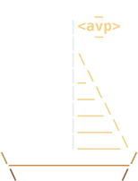

<div align="center">
  
  <h1>Agent Voyager Project (AVP)</h1>
</div>

> **Status:** Draft v0.1

AVP is an open standard for running and observing AI agents. A supervisor sends a JSON **Commission** with the task, model, and resources. The agent streams back a **Trajectory** of model calls, tool calls, usage, cost, and outcome.

```text
Supervisor ─── Commission ──▶ Agent
Supervisor ◀── Trajectory ─── Agent
```

AVP builds on CloudEvents, OpenTelemetry, MCP, and Agent Skills. See the [foundations](FOUNDATIONS.md) for how they fit together.

## Start with the AVP skill

Install the official skill for your coding agent (requires Node.js 22 or newer):

```bash
npx skills add portofcontext/agent-voyager-project --skill avp
```

Then ask: **“Use the AVP skill to set up and run my first agent evaluation.”**
The skill guides setup, Commission configuration, evaluations, and debugging.
See [SKILL.md](SKILL.md) for its instructions, or follow the CLI quickstart below.

## CLI quickstart

Requires **macOS or Linux**, [uv](https://docs.astral.sh/uv/getting-started/installation/), and a running Docker daemon. The CLI runs agents in containers and manages the sandbox setup.

```bash
uv tool install avp-cli
avp agent install goose
export ANTHROPIC_API_KEY="<your-api-key>"
avp init capitals --agent goose
avp eval run capitals.eval.json
```

This example makes paid model calls and ranks Commission variants by accuracy, pass rate, cost, and turns. The first run builds the agent's container image.

To give an agent a task in your own project:

```bash
avp env create myproj --image python:3.12-slim --path ./my-project
avp run --agent goose --env myproj "Add type hints to utils.py, then run the tests"
```

Each run uses a copy of your project and prints the resulting workspace path. See the [CLI guide](avp-cli/README.md) for comparing agents, configuring models, credentials, and sandboxing.

## Integrate an agent

Adapters in this repository:

| Runtime | Adapter |
|---|---|
| Claude Agent SDK | [avp-claude-agent-sdk](agents/avp-claude-agent-sdk/python/) |
| Goose | [avp-goose](agents/avp-goose/rust/) |
| OpenAI Agents SDK | [avp-openai-agents](agents/avp-openai-agents/python/) |
| Codex | [avp-codex](agents/avp-codex/python/) |

To add another runtime, follow the [adapter guide](agents/_template/README.md). See [integration patterns](PATTERNS.md) for runtime adaptation and launch context.

## Specs and bindings

Each spec can be adopted independently:

- [Commission](avp/core/spec/v0.1/commission.md): the run configuration.
- [Trajectory](avp/core/spec/v0.1/trajectory.md): the execution event stream.
- [Agent Descriptor](avp/core/spec/v0.1/agent-descriptor.md): the agent's capabilities.

Typed bindings: [Python](avp/bindings/python/) · [Rust](avp/bindings/rust/) · [TypeScript](avp/bindings/typescript/). Validate integrations with the [conformance suite](avp/core/conformance/).

## Develop

```bash
git clone https://github.com/portofcontext/agent-voyager-project
cd agent-voyager-project
make sync && make check
```

See the [contributor guide](AGENTS.md), [spec proposals](proposals/), or `make help` for next steps.

Built by [Port of Context](https://github.com/portofcontext). [Issues](https://github.com/portofcontext/agent-voyager-project/issues) · [Discussions](https://github.com/portofcontext/agent-voyager-project/discussions).
