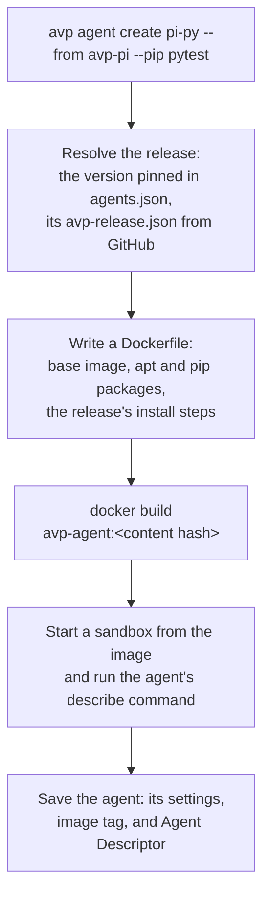
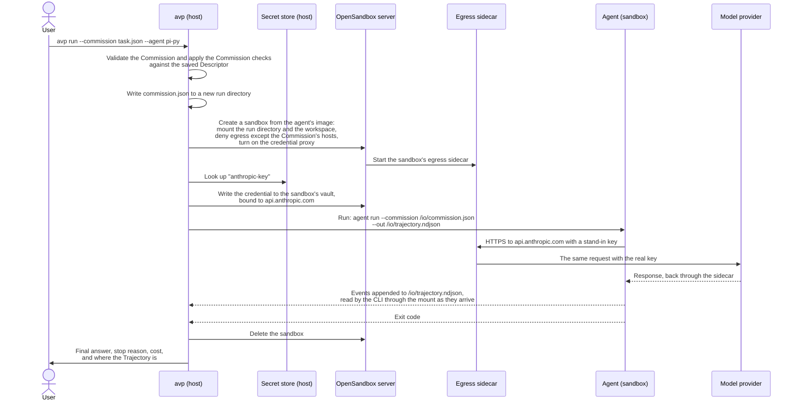

# avp command tree

The design for the new `avp` CLI, before any code. The old CLI is in
`avp-cli-legacy/` for reference only; nothing is copied from it.

## Decisions

- Every agent runs in a sandbox, and OpenSandbox is the only sandbox for now.
  Docker, podman, or the local machine can be added later.
- OpenSandbox needs a container engine with the Docker API: Docker, OrbStack,
  colima, or podman through its Docker socket. The CLI uses that API (found
  through `DOCKER_HOST` or the default socket) to build images, and never runs
  the `docker` or `podman` commands.
- Credentials go through OpenSandbox's Credential Vault. The CLI looks up each
  secret and writes it to the sandbox's vault; it runs no proxy of its own.
- An agent is an AVP agent release plus the environment it runs in. `agent`
  manages agents; `sandbox` manages only the OpenSandbox service they run on.
- `--agent` takes your agent (`pi-py`) or a release (`avp-pi`, `avp-pi@0.4.1`),
  which runs in a default environment.
- Commands use the AVP terms: `describe` returns the Agent Descriptor.
- Built with Typer.

## Commands

```text
avp
├── run                 Run one agent on one Commission and write its Trajectory.
│     avp run --commission task.json --agent pi-py [--out traj.ndjson] [--timeout 30m]
│     Later: avp run "fix the failing test" --agent pi-py --model anthropic/claude-sonnet-4-5,
│     which builds the Commission itself.
│
├── eval                Run datasets against agents and Commissions, and score the results.
│   ├── run     Run an eval file and print the scoreboard.
│   │     avp eval run capitals.eval.json [--agent pi-py --agent goose-py] [--model openai/gpt-5-mini]
│   │         [--max-items 20] [--threshold 0.8] [--resume RUN_ID] [--json]
│   ├── list    List past eval runs.
│   │     avp eval list [--limit 20]
│   ├── show    Show one run's scoreboard and per-item results.
│   │     avp eval show [RUN_ID] [--agent pi-py] [--json]
│   └── delete  Delete past runs and their trajectories.
│         avp eval delete RUN_ID | --all
│
├── conformance         Check that an agent follows the spec's rules for agents.
│   ├── check   Run the cases against an agent and report pass, fail, or skip by rule.
│   │     avp conformance check --agent pi-py [--model anthropic/claude-haiku-4-5]
│   │         [--rule trajectory.4.4] [--case tool-round-trip] [--keep-trajectories ./out] [--json]
│   └── list    List the cases and the rule each one covers.
│         avp conformance list [--rule trajectory.4.4]
│
├── agent               Agents: an AVP agent release plus the environment it runs in.
│   ├── create   Define an agent and build its sandbox image.
│   │     avp agent create pi-py --from avp-pi[@0.4.1 | ./agents/avp-pi/typescript]
│   │         [--image python:3.12] [--apt git] [--pip pytest] [--file ./repo:/workspace]
│   │         [--setup "make deps"] [--allow-host pypi.org] [--cpu 2] [--memory 4g]
│   │         [--like goose-py]
│   ├── list     List your agents with their release, version, and image status, or with
│   │            --available the AVP releases you can create from.
│   │     avp agent list [--available]
│   ├── describe Show the agent's Agent Descriptor, as its describe command returns it.
│   │     avp agent describe pi-py [--json]
│   ├── rebuild  Rebuild an agent's image after a release or working-copy change.
│   │     avp agent rebuild pi-py
│   ├── delete   Delete an agent and its image.
│   │     avp agent delete pi-py
│   └── exec     Run a command in a fresh sandbox of the agent, without the agent.
│         avp agent exec pi-py -- pytest -q
│
├── commission          Commission files.
│   ├── new     Write a Commission for an agent, with its built-in items listed.
│   │     avp commission new --agent pi-py --model openai/gpt-5-mini [--prompt "..."] > task.json
│   └── check   Validate a Commission and apply the Commission checks for an agent.
│         avp commission check task.json [--agent pi-py]
│
├── secret              Credentials that the broker passes to agents and MCP servers.
│   ├── set     Store a secret under a name a Commission can refer to.
│   │     avp secret set anthropic [VALUE]
│   ├── login   Sign in to an MCP server with OAuth and store the token.
│   │     avp secret login linear --url https://mcp.linear.app/mcp [--scope read]
│   ├── list    List secret names and where each comes from (environment, file, OAuth).
│   │     avp secret list
│   └── delete  Delete a secret.
│         avp secret delete anthropic
│
└── sandbox             The OpenSandbox service every agent runs on.
    ├── start   Start the service. Agent commands also start it when needed.
    │     avp sandbox start
    ├── stop    Stop the service and any sandboxes still running.
    │     avp sandbox stop
    └── status  Show whether the service is running, where, and whether Docker is reachable.
          avp sandbox status
```

## How an agent is created and run

One agent is one image. OpenSandbox runs images but doesn't build them, so
the CLI builds the image itself and OpenSandbox starts a fresh sandbox from it
for each run. Everything that changes per run (the Commission, the workspace,
the credentials) reaches the sandbox at run time, never through the image.

### Create



### Run



The command inside the sandbox is the agent command line from the SDK
(`avp.agent_cli`): `run --commission <path> --out <path>`. The release says
which program answers it.

## Open

1. Agent definitions as files (an `avp-agent.json` that can be committed next
   to an eval) or as state under `~/.avp`.
2. Removing the saved-Commission library: `run --commission` takes a path.
3. Removing `init` and the catalog templates, for an example eval file in the docs.
4. Removing the eval TUI and `eval share`/`unshare`: `eval show --json` covers
   reading results from scripts.
5. Keeping MCP OAuth (`secret login`).
6. Credential names: the default name a Commission uses for a model's key (the
   provider ID?), and whether a key already in the shell's environment counts.
7. What `run` prints, and where the Trajectory goes without `--out`
   (`~/.avp/runs/<run_id>/`?).
8. OpenSandbox's Credential Vault as the proxy for `proxy` credentials, as
   drawn above, in place of the legacy broker. It needs OpenSandbox 1.2.0 (we
   pin 0.1.9 and server 0.1.14), the egress sidecar in `dns+nft` mode, and a
   deny-by-default network policy. To check: how the sandbox trusts the
   sidecar's HTTPS interception, and OAuth, which the vault doesn't refresh.
