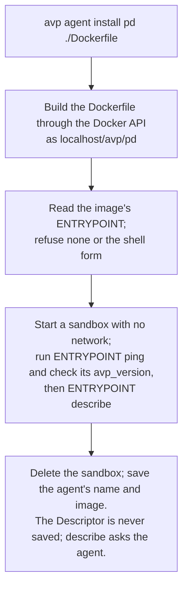
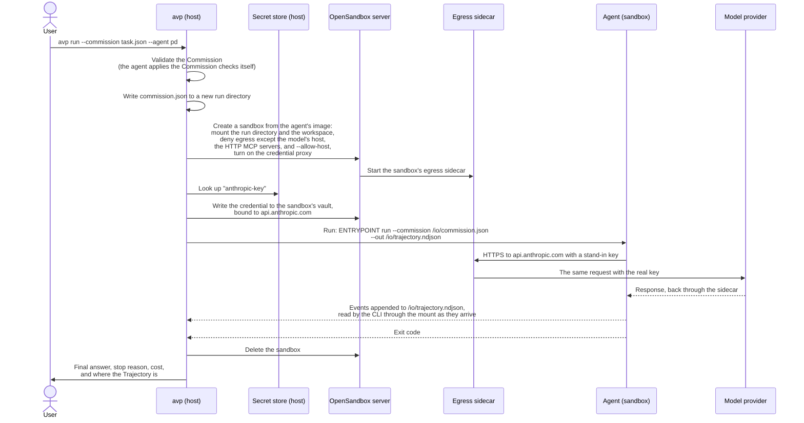

# avp command tree

The design for the new `avp` CLI. Commands not built yet raise
NotImplementedError. The old CLI is in
`avp-cli-legacy/` for reference only; nothing is copied from it.

## Decisions

- Every agent runs in a sandbox, and OpenSandbox is the only sandbox for now.
  Docker, podman, or the local machine can be added later.
- OpenSandbox needs a container engine with the Docker API: Docker, OrbStack,
  colima, or podman through its Docker socket. The CLI uses that API (found
  through `DOCKER_HOST` or the default socket) to build images, and never runs
  the `docker` or `podman` commands.
- Credentials go through OpenSandbox's Credential Vault. The CLI looks up each
  secret and writes it to the sandbox's vault; it runs no proxy of its own.
- An agent is an image whose ENTRYPOINT is an AVP agent command line: it
  answers `ping`, `describe`, and `run --commission --out`. Its Dockerfile says
  how it installs; avp knows nothing about the agent's language or packages.
- `agent` manages agents; `sandbox` manages only the OpenSandbox service they
  run on. `--agent` takes an installed agent's name.
- Commands use the AVP terms: `describe` returns the Agent Descriptor.
- Built with Typer.

## Commands

```text
avp
├── run                 Run one agent on one Commission and write its Trajectory.
│     avp run --commission task.json --agent pd [--env NAME=VALUE | NAME] [--env-file .env]
│         [--allow-host pypi.org] [-v ./testing/mcp:/mcp:ro] [--out traj.ndjson] [--timeout 30m]
│     The agent's environment has only the variables --env and --env-file give. It can
│     reach only the model's host (model.base_url, or avp's default for the provider),
│     the Commission's HTTP MCP servers, and the hosts --allow-host adds. --volume
│     (-v) mounts a host path, read-write unless it ends in :ro.
│
├── eval                Run datasets against agents and Commissions, and score the results.
│   ├── run     Run an eval file and print the scoreboard.
│   │     avp eval run capitals.eval.json [--agent pd --agent my-agent] [--model openai/gpt-5-mini]
│   │         [--max-items 20] [--threshold 0.8] [--resume RUN_ID] [--json]
│   ├── list    List past eval runs.
│   │     avp eval list [--limit 20]
│   ├── show    Show one run's scoreboard and per-item results.
│   │     avp eval show [RUN_ID] [--agent pd] [--json]
│   └── delete  Delete past runs and their trajectories.
│         avp eval delete RUN_ID | --all
│
├── conformance         Check that an agent follows the spec's rules for agents.
│   ├── check   Run the cases against an agent and report pass, fail, or skip by rule.
│   │     avp conformance check --agent pd [--model anthropic/claude-haiku-4-5]
│   │         [--rule trajectory.4.4] [--case tool-round-trip] [--keep-trajectories ./out] [--json]
│   └── list    List the cases and the rule each one covers.
│         avp conformance list [--rule trajectory.4.4]
│
├── agent               Agents: an image whose ENTRYPOINT is an AVP agent command line.
│   ├── install    Build the agent's image, check it answers ping and describe in a
│   │              sandbox, and save it. Installing over an agent replaces it.
│   │     avp agent install pd agents/avp-pydantic-ai/python/Dockerfile [--context .]
│   ├── list       List your agents.
│   │     avp agent list
│   ├── ping       Check that the agent starts in a sandbox, without loading it.
│   │     avp agent ping pd
│   ├── describe   Print the agent's Agent Descriptor, from its describe in a sandbox.
│   │     avp agent describe pd
│   ├── uninstall  Remove an agent and its image.
│   │     avp agent uninstall pd
│   └── exec       Run a command in a fresh sandbox of the agent, without the agent.
│         avp agent exec pd -- pytest -q
│
├── commission          Commission files.
│   ├── new     Write a Commission for an agent, with its built-in items listed.
│   │     avp commission new --agent pd --model openai/gpt-5-mini [--prompt "..."] > task.json
│   └── check   Validate a Commission and apply the Commission checks for an agent.
│         avp commission check task.json [--agent pd]
│
├── secret              Credentials that the broker passes to agents and MCP servers.
│   ├── set     Store a secret under a name a Commission can refer to.
│   │     avp secret set anthropic [VALUE]
│   ├── login   Sign in to an MCP server with OAuth and store the token.
│   │     avp secret login linear --url https://mcp.linear.app/mcp [--scope read]
│   ├── list    List secret names and where each comes from (environment, file, OAuth).
│   │     avp secret list
│   └── delete  Delete a secret.
│         avp secret delete anthropic
│
└── sandbox             The OpenSandbox service every agent runs on.
    ├── start   Start the service. Agent commands also start it when needed.
    │     avp sandbox start
    ├── stop    Stop the service and any sandboxes still running.
    │     avp sandbox stop
    └── status  Show the container engine and where avp found it, and whether the service is running.
          avp sandbox status
```

## How an agent is installed and run

One agent is one image. OpenSandbox runs images but doesn't build them, so
the CLI builds the image itself and OpenSandbox starts a fresh sandbox from it
for each command, deleted when the command ends. Each sandbox starts idle, and
the CLI runs the image's ENTRYPOINT in it through OpenSandbox's exec daemon,
so it can fill the vault first and gets the command's exit code and output. Everything that changes per run (the Commission, the workspace,
the credentials) reaches the sandbox at run time, never through the image.

### Install



To add tools to an AVP agent, build on its image: `FROM localhost/avp/pd`,
then `RUN pip install pytest`.

### Run



The command inside the sandbox is the image's ENTRYPOINT, read through the
Docker API, with the agent command line's arguments after it. The SDKs provide
that command line (`avp.agent_cli` in Python).

## Open

1. Installed agents are state under `~/.avp/agents/`. An eval file could name
   a Dockerfile instead, to be committed with it.
2. Removing the saved-Commission library: `run --commission` takes a path.
3. Removing `init` and the catalog templates, for an example eval file in the docs.
4. Removing the eval TUI and `eval share`/`unshare`: `eval show --json` covers
   reading results from scripts.
5. Keeping MCP OAuth (`secret login`).
6. Credential names: the default name a Commission uses for a model's key (the
   provider ID?), and whether a key already in the shell's environment counts.
7. What `run` prints, and where the Trajectory goes without `--out`
   (`~/.avp/runs/<run_id>/`?).
8. OpenSandbox's Credential Vault as the proxy for `proxy` credentials, as
   drawn above, in place of the legacy broker. It needs the egress sidecar in
   `dns+nft` mode and a deny-by-default network policy. The server installs
   its interception certificate in the sandbox's system trust store; to check:
   whether Python agents need `SSL_CERT_FILE`, since httpx trusts certifi's
   bundle, and OAuth, which the vault doesn't refresh.
9. Installing the project's own agents by name and version, without a
   checkout, once the SDK and agents are published.
