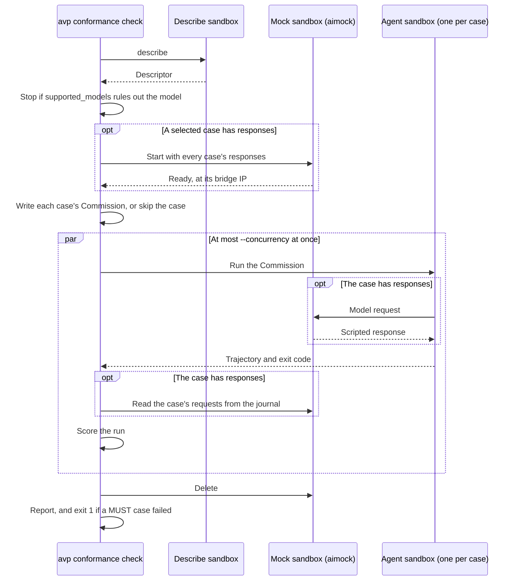

# Conformance

`avp conformance check` runs cases against an installed agent and reports pass,
fail, or skip by spec rule. It makes no real model calls and needs no provider
key.

```sh
avp conformance check --agent pd [--model openai/gpt-5-mini] [--concurrency 4]
```

## Lifecycle



## Cases

Each case covers one rule, writes a Commission from the agent's Descriptor, and
checks the run. A check can read the Trajectory, the agent's answer to
`describe`, the Commission sent, and the requests the mock received.
`avp conformance list` shows every rule and its cases.

| Rule | What the cases check | Uses the mock |
|---|---|---|
| `commission.5.1` | The agent refuses an invalid Commission with `invalid_commission` | No |
| `commission.5.2` | `enabled_*` lists limit the built-in items in `agent_started` | Yes |
| `commission.5.3` | A turned-off tool isn't offered, and a call to it fails | Yes |
| `commission.5.4` | Added items are used, and a server that won't connect stops the run | Some |
| `commission.5.5` | The model's system prompt is only `system_prompt` | Yes |
| `commission.5.6` | Model requests ask for `model.id` | Yes |
| `commission.5.7` | Output is checked against `output_schema` | Yes |
| `commission.5.8` | A secret's value is in no event | Yes |
| `commission.5.9` | `env` secrets reach the model and MCP servers | Yes |
| `agent-descriptor.4.1` | Names and IDs are unique | No |
| `agent-descriptor.4.2` | `agent_described` omits added items | Yes |
| `agent-descriptor.4.4` | MCP tools name their server, and connected servers list their tools | Some |
| `agent-descriptor.4.5` | Tools match what the model is offered | Yes |
| `agent-descriptor.4.6` | A run's Descriptor matches `describe` | No |
| `trajectory.4.1` | Events come in order, with unique IDs | Yes |
| `trajectory.4.2` | The first events record the Commission, Descriptor, and added items | Some |
| `trajectory.4.3` | One `assistant_message` per response, with every block | Yes |
| `trajectory.4.4` | Usage counts only its own response | Yes |
| `trajectory.4.5` | Every tool call has a result, and a failed call has `is_error` | Yes |
| `trajectory.4.7` | A failed run ends with `error_occurred`, then `agent_stopped` | Yes |

- **Fail:** the case's check finds a problem, a line isn't a valid event, there is
  no Trajectory, or the agent exits nonzero.
- **Skip:** the Descriptor lacks what the case needs, such as built-in tools.
- **Exit code:** 1 only when a MUST case fails. A SHOULD failure is still reported.

### Not covered

| Requirement | Why |
|---|---|
| `agent-descriptor.4.3` | It says what absent lists mean. An agent has no behavior to check. |
| `trajectory.4.6`, subagents | The Descriptor doesn't say how to start a subagent, so a case can't script it. |
| `trajectory.4.7`, stopping from outside | The engine can't signal a running agent yet. |
| `commission.5.9`, `proxy` secrets | A case would need a credential in `avp vault`. |
| `commission.5.9`, the API key's value | aimock's journal redacts it, so a case sees only that a key was sent. |
| `commission.5.1`, a model the service doesn't offer | It applies only when the agent knows this. |
| `agent-descriptor.4.2`, all built-in items | Only the agent knows what it has. |

## Mocking

A case that needs a model lists its responses:

```python
Case(
    name="events-in-order",
    ...,
    responses=({"content": "A scripted reply."},),
)
```

A case with responses runs against [aimock](https://github.com/CopilotKit/aimock).
Responses are written once in aimock's format, and aimock answers in the format
of the provider `--model` names. A second provider is a second check.

The image is pinned by digest in `conformance/mock.py`. `--mock-image` runs
another aimock image for one check.

A request no case scripted gets a 503, not an invented reply.

A case's responses can also be written from the Descriptor, to call a built-in
tool by name.

A case can list MCP tools. aimock serves them at `/mcp/<case name>`, and the case's
Commission adds that server. A scripted tool call names the tool exactly, so an
agent that renames MCP tools sees an unknown tool. The call still needs a result,
so the tool call case doesn't require the tool to have run.

The journal stores every provider's request in one form, so checks read one
shape. It loses Google's tool input schemas, and it redacts API keys.

### Cases running at once

One mock serves the whole check. It holds every case's responses from the start,
and nothing about a run is stored on the mock, so runs can't affect each other.
Each request is matched on two values from the request itself:

| Field | Value | Purpose |
|---|---|---|
| `userMessage` | `[avp-conformance <case name>]`, the case's prompt | Which case |
| `turnIndex` | The number of assistant messages in the request | Which response |

For a case with two responses:

```json
[
  { "match": { "userMessage": "[avp-conformance two-turns]", "turnIndex": 0 }, "response": { "content": "First" } },
  { "match": { "userMessage": "[avp-conformance two-turns]", "turnIndex": 1 }, "response": { "content": "Second" } }
]
```

aimock matches part of the message, so the brackets stop `a-case` from matching
inside `a-case-2`.

aimock reads only the last user message, and a retry's holds the agent's complaint.
A case with retries sets `system_prompt` to the same text and matches on
`systemMessage` instead.

A check reads the journal for its own requests: those holding its prompt, or those
to its MCP path. Runs at the same time don't mix.

## Networking

Every sandbox denies outbound traffic by default.

| Sandbox | Can reach | `model.base_url` |
|---|---|---|
| Agent, case with responses | The mock's bridge IP, port 4010 | The mock's address plus the provider's path |
| Agent, other cases | Only hosts the Commission names | `http://conformance.invalid`, which never resolves |
| Mock | Nothing | None |

An agent's allowed hosts come from its Commission's `model.base_url` and HTTP MCP
servers, so pointing `base_url` at the mock is what allows it. An agent can't
reach a real provider. Its credential is a stand-in.

### Provider paths

aimock serves each API at that API's own path, and each SDK adds part of that
path to `base_url`.

| Provider | `base_url` | Request |
|---|---|---|
| `anthropic` | `http://<ip>:4010` | `/v1/messages` |
| `google` | `http://<ip>:4010` | `/v1beta/models/<id>:generateContent` |
| `openai` | `http://<ip>:4010/v1` | `/v1/responses` |

A case with responses stops the check for any other provider. The table is
`PATHS` in `conformance/mock.py`.
